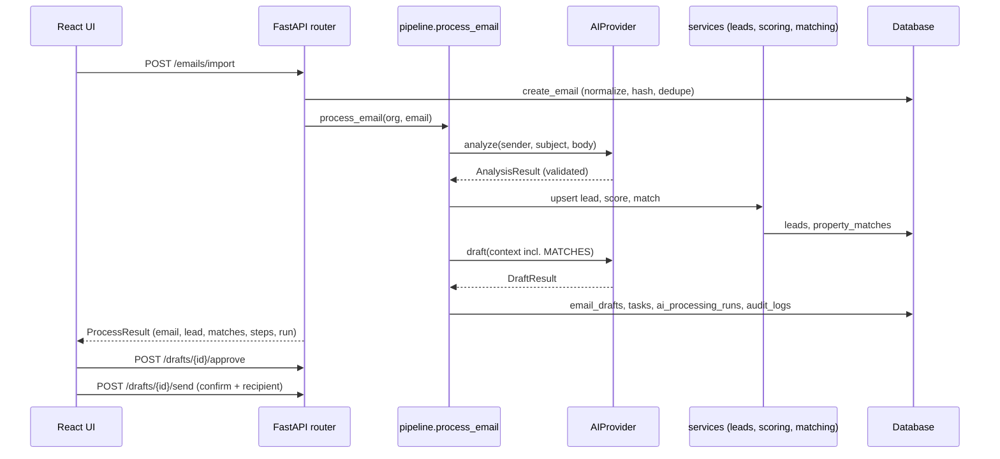
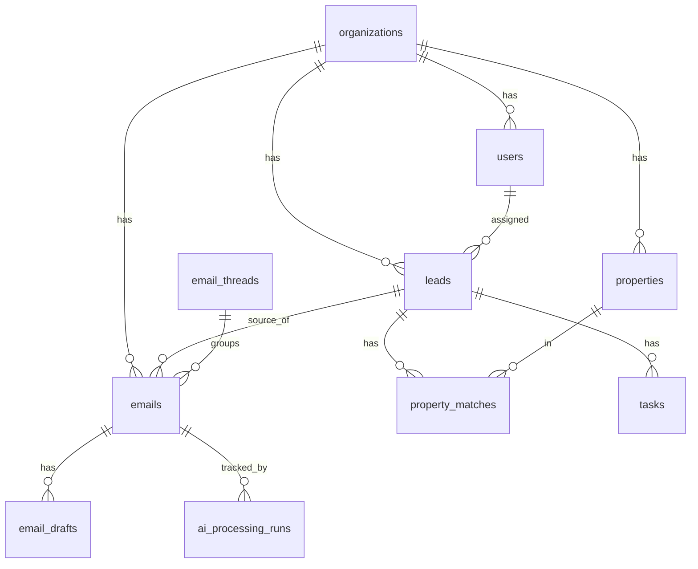

# EstatePilot AI - Architecture

Short technical companion to chapters 3, 8 and 9 of `ESTATEPILOT_AI_COMPLETE_GUIDE.md`. Everything here reflects the code as of version 1.0.0.

## 1. Components

```
Browser (React SPA, Vite :5173 / nginx :3000)
        |  JSON over HTTP, Authorization: Bearer <JWT>
        v
FastAPI app (backend/app/main.py)  -- CORS from CORS_ORIGINS
  api/           routers: auth, leads, properties, tasks, emails, misc (automation, audit, settings, analytics, integrations)
  core/          config (env), deps (RBAC, pagination), security (bcrypt, JWT, Fernet, rate limiter)
  services/      scoring, matching, leads, emails, analytics, audit, orgs
  agents/        pipeline, providers (demo/openai/gemini), demo_provider, nlp, schemas
  integrations/  gmail (OAuth, sync, send)
  models/ db/    SQLAlchemy models, session, seed
        |
        +--> SQLite file (default) or another SQLAlchemy URL (untested)
        +--> OpenAI / Gemini HTTPS APIs (optional)
        +--> Gmail API (optional)
Power BI (manual) <-- SQL views (powerbi/sql/views.sql) or CSV exports
```

## 2. Layering rules

- Routers handle HTTP, authorisation and transactions (`db.commit()`); they call services and the pipeline.
- Services hold deterministic business rules and are free of HTTP concerns.
- The pipeline is the only place that sequences AI, lead, scoring, matching, drafting and task creation.
- Providers return validated pydantic objects (`AnalysisResult`, `DraftResult`); nothing outside `agents/` parses model text.
- Every row is scoped by `organization_id`; the JWT carries `sub`, `org`, `role`, `exp`, `typ=access`.

## 3. Pipeline sequence



## 4. Pipeline steps and rules

| Step | Details |
|---|---|
| normalize | strip script/style/tags, unescape HTML, collapse whitespace, 20,000 char cap |
| dedupe | SHA-256 over lower-cased sender + collapsed subject + collapsed body, unique per organisation; Gmail also unique per message id |
| classify / extract / validate | provider output validated by `AnalysisResult`; retries `AI_MAX_RETRIES` |
| lead | upsert by email, then normalised phone; spam and other create no lead |
| score | 0-100 rules, stored with reasons |
| match | 0-100 per property, minimum 50, top 10 |
| draft | grounded on matches; status `draft` |
| task | one pending AI follow-up per lead, due 4/24/48/72 h for hot/high/medium/low |
| record | `ai_processing_runs` with steps, `audit_logs` entries, notification for new hot leads and failures |

Controls checked at the start of processing: organisation `paused`, `kill_switch`, and per-rule `enabled` flags (process_incoming_emails, create_update_leads, generate_reply_drafts, create_followup_tasks).

## 5. Data model summary

14 tables; see chapter 8 of the guide for columns and indexes.



Time: all timestamps are UTC. `UTCDateTime` stores naive UTC and returns aware UTC. API output ends with `Z`.

## 6. Security architecture (summary)

bcrypt passwords; HS256 JWT; role hierarchy admin > manager > agent > analyst checked by dependency functions; Fernet-encrypted Gmail tokens; signed OAuth state; login rate limit; send gate (approval, confirmation, kill switch, `SENDING_ENABLED`). Known gaps are listed in chapter 17 of the guide. Not production-ready.

## 7. Deployment shapes

| Shape | Status |
|---|---|
| Local: uvicorn + Vite dev server + SQLite | Verified |
| Docker Compose: backend (SQLite in volume) + nginx frontend | Written, UNVERIFIED |
| PostgreSQL | Compose service present behind profile `postgres`; backend not wired to it, no driver in `requirements.txt`; UNVERIFIED |

## 8. Extension points

- New AI provider: subclass `_LLMBase` (guide section 9.9).
- New scoring factor: add to `score_lead`, update tests in `test_scoring_rules`.
- New matching criterion: add to `score_property` and keep the 100-point budget balanced.
- New analytics view: add to `powerbi/sql/views.sql` and the data dictionary.
